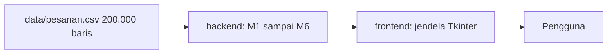

# 2EZ4U APP

Engine backend layanan antar makanan/barang versi mini (semacam GoFood/GrabFood).
Proyek akhir **Struktur Data & Analisa Algoritma (EC234303)**, Departemen Teknik Komputer, FTEIC-ITS.

- Bahasa: Python 3.11+
- UI: Tkinter
- Data: 200.000 baris `data/pesanan.csv` dan `data/peta.csv`
- Aturan: semua struktur data dan algoritma dibuat sendiri, tanpa `dict`, `set`, `sorted`, `.sort()`, `heapq`, `bisect`, `collections`, maupun literal `{}`.

## Status milestone

| Milestone | Isi | Berkas | Status |
|---|---|---|---|
| M1 | Array vs Linked List | `backend/m1_pesanan.py` | Selesai |
| M2 | Stack, Queue, Undo/Redo | `backend/m2_antrean.py` | Selesai |
| M3 | Sort dan Search | `backend/m3_laporan.py` | Selesai |
| M4 | Hash table dan merge sort | `backend/m4_pencarian.py` | Belum |
| M5 | BST dan MinHeap | `backend/m5_katalog.py` | Belum |
| M6 | Graf, BFS, Dijkstra | `backend/m6_peta.py` | Belum |

## Struktur repositori

```
2ez4u/
|-- README.md
|-- app.py
|-- data/
|   |-- pesanan.csv
|   |-- peta.csv
|-- backend/
|   |-- m1_pesanan.py
|   |-- m2_antrean.py
|   |-- m3_laporan.py
|-- frontend/
    |-- ui.py
```

## Cara menjalankan

1. Pastikan Python 3.11 atau lebih baru sudah terpasang.
2. Clone repo ini:
   ```
   git clone https://github.com/hakimsuhardi2006-wow/2ez4u.git
   cd 2ez4u
   ```
3. Jalankan tes tiap modul backend:
   ```
   python backend/m1_pesanan.py
   python backend/m2_antrean.py
   python backend/m3_laporan.py
   ```
   Hasil yang diharapkan: `Array OK`, `LinkList OK`, `M2 OK`, `M3 OK`.
4. Jalankan aplikasi (setelah UI selesai):
   ```
   python app.py
   ```

## Diagram arsitektur



## M1: Array vs Linked List

Pesanan disimpan di dua struktur sekaligus dengan lima operasi yang sama.

| Operasi | Array | Linked List |
|---|---|---|
| Lihat pesanan ke-i | O(1) | O(n) |
| Tambah REGULER (belakang) | O(1) amortized | O(1) berkat `tail` |
| Tambah PRIORITAS (tengah) | O(n) geser | O(n) telusur |
| Tambah VIP (depan) | O(n) geser | O(1) |
| Hapus pesanan ke-i | O(n) | O(n) telusur |

Catatan desain:
- Array digandakan kapasitasnya saat penuh, sehingga `append` menjadi O(1) amortized.
- Linked List menyimpan `head` dan `tail`. Saat simpul terakhir dihapus, `tail` ikut diperbarui.
- Kedua struktur mencatat jumlah geseran/telusuran agar bisa dibandingkan di UI.

## M2: Stack dan Queue

- **Stack** dibangun di atas Array M1 (`push`, `pop`, `peek`, `kosong`).
- **Kasir:** `ke_postfix` mengubah infix ke postfix memakai stack operator, `hitung` mengevaluasi postfix memakai stack angka. Operand kanan di-`pop` lebih dulu agar `-` dan `/` benar.
- **Antrean naif** memakai larik dan menggeser seluruh isi saat `dequeue` (O(n)).
- **Antrean melingkar** hanya menggeser penunjuk `front` dengan `(i+1) % K` (O(1)).
  Penjaga kosong/penuh memakai pencacah `count`, bukan `front == rear`, karena keduanya tidak bisa dibedakan. Bila penuh, antrean **tumbuh dua kali lipat**.
- **Undo/Redo:** tiap aksi di-push ke stack undo beserta daftar pesanannya. Undo `DEQUEUE` mengembalikan seluruh daftar ke depan antrean. Aksi baru mengosongkan stack redo.

## M3: Sort dan Search

Setiap algoritma melaporkan **jumlah perbandingan** lewat objek `Pencacah`.

- `insertion_sort`: di tempat, stabil (menggeser hanya bila lebih besar), O(n²). Menolak data di atas 20.000 baris dengan pesan.
- `merge_sort`: stabil (memakai `<=` saat menggabung), O(n log n), sisa kiri dan kanan disalin.
- `linear_search`: O(n), tidak butuh data terurut.
- `binary_search`: O(log n), butuh data terurut menurut kunci yang dicari.

### Tabel n vs jumlah perbandingan

Data acak sintetis, kunci integer, hasil dari tes di `backend/m3_laporan.py`.

| n | Insertion sort | Merge sort |
|---|---|---|
| 1.000 | 242.690 | 8.693 |
| 2.000 | 986.011 | 19.443 |
| 4.000 | 4.020.117 | 42.865 |

Saat n dilipatduakan, perbandingan insertion sort naik sekitar 4 kali (kuadratik), sedangkan merge sort sekitar 2 kali (n log n).

<!-- TODO: tempel grafik n vs perbandingan di sini -->

### Alasan memilih algoritma

- **Insertion sort** cocok untuk data kecil atau hampir terurut, tetapi tidak untuk 200.000 baris.
- **Merge sort** dipakai untuk data penuh karena kinerjanya stabil O(n log n) apa pun kondisi datanya.
- **Linear search** dipakai untuk pencarian sekali dua kali, karena tidak perlu biaya pengurutan.
- **Binary search** baru untung bila pencarian dilakukan berkali-kali pada daftar yang sudah terurut menurut `oid`.

## Screenshot

<!-- TODO: tambahkan screenshot UI setelah frontend selesai -->

## Video demo

<!-- TODO: tambahkan link video demo -->

## Catatan penting

- Kolom `t_selesai_detik` kosong untuk pesanan berstatus CANCEL/ANTRE, sehingga laporan harian disaring hanya untuk DONE atau diberi nilai besar untuk yang kosong.
- Tag `m1`, `m2`, `m3` menandai tiap milestone.
